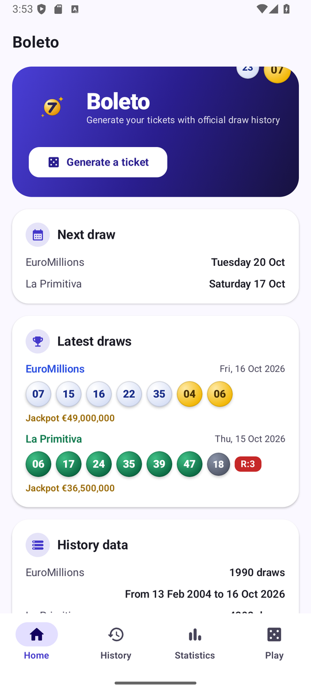
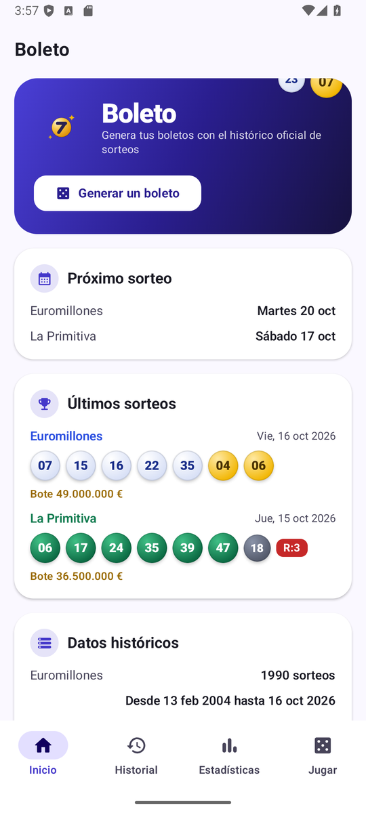
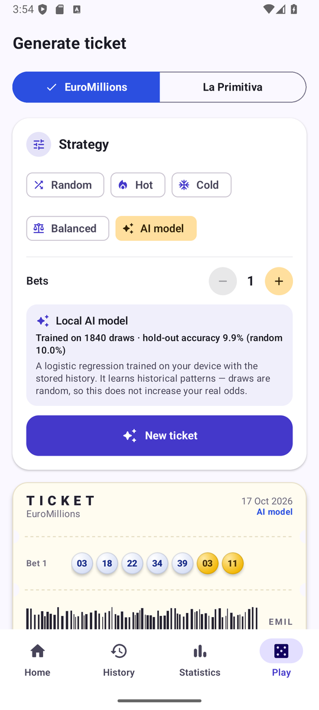
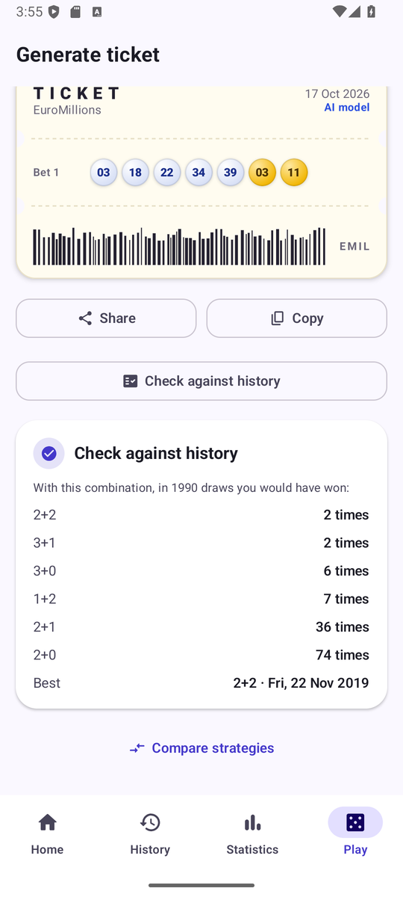
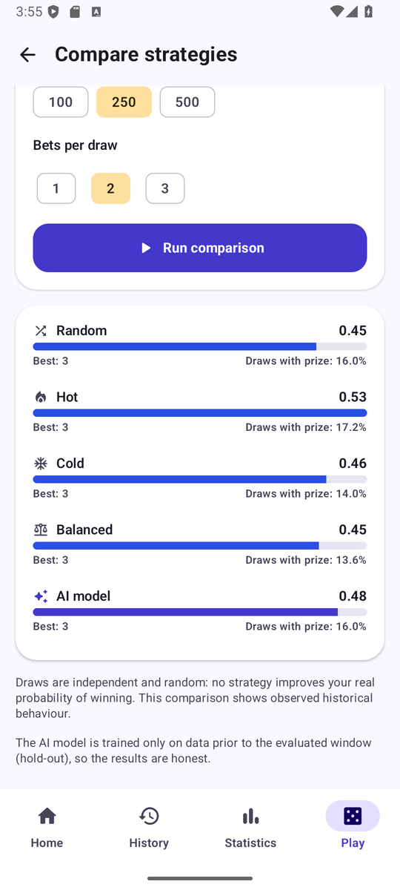
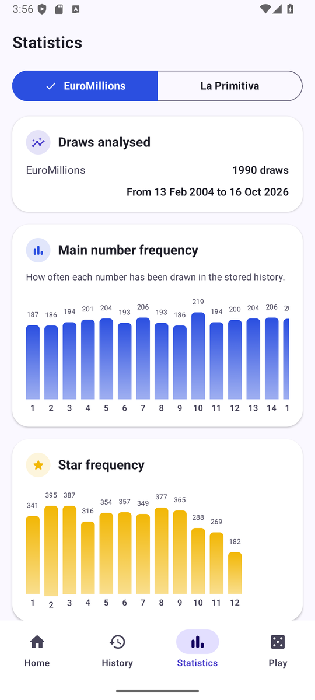
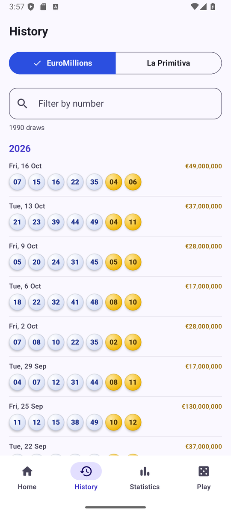

# Boleto 🎟️

[English](#-english) · [Español](#-español)

<p align="center">
  
</p>

---

## 📱 Screenshots

| Home | Inicio | Generated ticket | Check against history |
|:---:|:---:|:---:|:---:|
|  |  |  |  |
| Compare strategies | Statistics | History | |
|  |  |  | |

---

## 🇬🇧 English

**Boleto** is an open-source Android app (Kotlin + Jetpack Compose) that keeps the complete official draw
history of **EuroMillones** and **La Primitiva** up to date and generates tickets to play — with an
**on-device AI model** and an **honest walk-forward backtest** of every strategy.

### Features

| | |
|---|---|
| 📥 **Full history included** | La Primitiva since 1985 (4.200+ draws) and EuroMillones since 2004 (1.990 draws) are bundled as assets, so the app works offline from the very first launch. One tap syncs the latest draws from the official source. |
| 🎯 **Ticket generator** | 5 strategies: random, hot, cold, balanced and a local AI model. 1–8 bets per ticket for La Primitiva, 1–5 for EuroMillones, with refund digit. |
| 🧠 **Local AI model** | A logistic regression written in pure Kotlin (no TensorFlow/LiteRT needed) trained on your device with the stored history: rolling frequencies (10/25/50/100/250 draws), delay, and day/month seasonality. Features are standardised, the model is cached on disk and retrained automatically when the history changes. |
| 🤖 **On-device generative AI** | On phones with Android AICore (Pixel 8/9/10, Galaxy S24+ and similar), the app offers to download **Gemini Nano** (~2 GB, once per device, shared by all apps) and uses it to explain the generated ticket in natural language. The prompt is grounded with the verified archive — numbers, frequencies, delays, hold-out metrics — so the model cannot invent data, and nothing ever leaves the phone. |
| 📊 **Statistics** | Number and star frequency charts, hot/cold numbers and the most overdue numbers. |
| 🔍 **Ticket checker** | See what a combination would have won across the whole archive, by official prize category. |
| ⚖️ **Strategy comparison** | Walk-forward evaluation of all five strategies over the last 100/250/500 draws, using only the data available before each draw. The AI model is trained exclusively on data prior to the evaluated window (hold-out). |
| 🌍 **Bilingual** | Full English and Spanish translations, per-app language support, light & dark themes, adaptive icon with monochrome variant. |

### ⚠️ Honesty note

Lottery draws are independent random events. **No model or strategy can increase the real probability of
winning.** The AI strategy explores historical patterns in the archive and the app always reports its
honest hold-out performance — typically indistinguishable from pure chance, which is exactly what the
backtest comparison shows.

Two different "AI models" live in the app, and it is worth keeping them apart:

* the **logistic regression** is the one *trained on your device* from the downloaded history;
* **Gemini Nano** is a pre-trained *system* model provided by Android AICore. It cannot be trained
  locally: it is downloaded on demand and used only to **narrate** the ticket, always from verified data.

Play responsibly.

### Data sources

* **Primary**: official [Loterías y Apuestas del Estado](https://www.loteriasyapuestas.es) web service
  (`buscadorSorteos`), which serves both games. The endpoint returns at most 115 draws per request, so the
  app walks the calendar in windows and splits truncated responses automatically.
* **Fallback**: community EuroMillions API, used only when the official service is unreachable.

### Project layout

```
app/src/main/java/com/manalejandro/boleto/
├── core/        HTTP, ISO dates, locale formatting
├── data/        models, LAE client, CSV history store, preferences, repository
├── domain/      statistics, prize rules, ticket generator, backtester
│   └── ai/      feature extractor, logistic regression, trainer
│       └── ondevice/  Gemini Nano integration (ML Kit GenAI) and prompt builder
└── ui/          Material 3 theme, components, screens, ViewModel
tools/
├── fetch_history.py   rebuilds the bundled archives from the official service
└── make_icons.py      regenerates the legacy launcher icons
```

### Build

```bash
./gradlew assembleDebug        # installable APK  → app/build/outputs/apk/debug/
./gradlew assembleRelease      # minified APK (sign it to distribute)
./gradlew testDebugUnitTest    # 24 unit tests, including the real bundled archives
```

Requirements: JDK 17+ and Android SDK 37. `minSdk 26`, `targetSdk 37` (API 26 is required by ML Kit's
GenAI APIs; on older phones the app would not be installable, so the whole app targets Android 8+).

### Tech

Kotlin 2.2 · Jetpack Compose (Material 3) · AGP 9.4 · coroutines · ML Kit GenAI Prompt API (Gemini Nano,
optional) · no other third-party runtime dependencies (HTTP through `HttpURLConnection`, JSON through
`org.json`, history stored as CSV).

### License

MIT — see [LICENSE](LICENSE).

---

## 🇪🇸 Español

**Boleto** es una aplicación Android de código abierto (Kotlin + Jetpack Compose) que mantiene actualizado
el histórico oficial completo de sorteos de **Euromillones** y **La Primitiva** y genera boletos para
jugar — con un **modelo de IA local** y una **comparación honesta de estrategias** mediante backtesting.

### Características

| | |
|---|---|
| 📥 **Histórico completo incluido** | La Primitiva desde 1985 (más de 4.200 sorteos) y Euromillones desde 2004 (1.990 sorteos) vienen empaquetados, así que la app funciona sin conexión desde el primer arranque. Un toque sincroniza los últimos sorteos desde la fuente oficial. |
| 🎯 **Generador de boletos** | 5 estrategias: aleatoria, calientes, fríos, equilibrada y modelo de IA local. De 1 a 8 apuestas por boleto en La Primitiva y de 1 a 5 en Euromillones, con reintegro. |
| 🧠 **Modelo de IA local** | Una regresión logística escrita en Kotlin puro (sin TensorFlow/LiteRT) entrenada en tu dispositivo con el histórico guardado: frecuencias en ventanas de 10/25/50/100/250 sorteos, retraso y estacionalidad por día y mes. Las variables se estandarizan, el modelo se guarda en disco y se reentrena automáticamente cuando cambia el histórico. |
| 🤖 **IA generativa en el dispositivo** | En teléfonos con AICore de Android (Pixel 8/9/10, Galaxy S24+ y similares), la app ofrece descargar **Gemini Nano** (~2 GB, una sola vez por dispositivo y compartido entre apps) y lo usa para explicar el boleto generado en lenguaje natural. El prompt va anclado con el histórico verificado — números, frecuencias, retrasos, métricas de validación — así que el modelo no puede inventarse datos, y nada sale del teléfono. |
| 📊 **Estadísticas** | Gráficas de frecuencia de números y estrellas, números calientes/fríos y los más retrasados. |
| 🔍 **Comprobador de boletos** | Consulta qué habría ganado una combinación en todo el histórico, por categoría oficial de premio. |
| ⚖️ **Comparación de estrategias** | Evaluación walk-forward de las cinco estrategias sobre los últimos 100/250/500 sorteos, usando solo los datos disponibles antes de cada sorteo. El modelo de IA se entrena exclusivamente con datos anteriores a la ventana evaluada (hold-out). |
| 🌍 **Bilingüe** | Traducciones completas al inglés y al español, idioma por aplicación, temas claro y oscuro, icono adaptativo con variante monocroma. |

### ⚠️ Nota de honestidad

Los sorteos de lotería son eventos aleatorios independientes. **Ningún modelo ni estrategia puede aumentar
la probabilidad real de ganar.** La estrategia de IA explora patrones históricos del archivo y la app
siempre muestra su rendimiento honesto en hold-out — normalmente indistinguible del puro azar, que es
justo lo que refleja la comparación de estrategias.

Conviene distinguir los dos "modelos de IA" que conviven en la app:

* la **regresión logística** es la que se *entrena en tu dispositivo* con el histórico descargado;
* **Gemini Nano** es un modelo *de sistema* ya entrenado que proporciona AICore de Android. No se puede
  entrenar localmente: se descarga bajo demanda y solo se usa para **narrar** el boleto, siempre a partir
  de datos verificados.

Juega con responsabilidad.

### Fuentes de datos

* **Principal**: servicio web oficial de [Loterías y Apuestas del Estado](https://www.loteriasyapuestas.es)
  (`buscadorSorteos`), que sirve ambos juegos. El endpoint devuelve como máximo 115 sorteos por petición,
  así que la app recorre el calendario por ventanas y divide automáticamente las respuestas truncadas.
* **Alternativa**: API comunitaria de Euromillones, usada solo si el servicio oficial no responde.

### Estructura del proyecto

```
app/src/main/java/com/manalejandro/boleto/
├── core/        HTTP, fechas ISO, formato por idioma
├── data/        modelos, cliente LAE, histórico en CSV, preferencias, repositorio
├── domain/      estadísticas, reglas de premios, generador de boletos, backtesting
│   └── ai/      extracción de características, regresión logística, entrenador
│       └── ondevice/  integración con Gemini Nano (ML Kit GenAI) y constructor del prompt
└── ui/          tema Material 3, componentes, pantallas, ViewModel
tools/
├── fetch_history.py   regenera los históricos empaquetados desde el servicio oficial
└── make_icons.py      regenera los iconos de lanzador heredados
```

### Compilar

```bash
./gradlew assembleDebug        # APK instalable  → app/build/outputs/apk/debug/
./gradlew assembleRelease      # APK minificado (fírmalo para distribuir)
./gradlew testDebugUnitTest    # 24 tests unitarios, incluidos los históricos reales
```

Requisitos: JDK 17+ y Android SDK 37. `minSdk 26`, `targetSdk 37` (la API 26 es obligatoria para las
APIs GenAI de ML Kit; en teléfonos anteriores la app no se instala, así que toda la app apunta a Android 8+).

### Tecnología

Kotlin 2.2 · Jetpack Compose (Material 3) · AGP 9.4 · coroutines · ML Kit GenAI Prompt API (Gemini Nano,
opcional) · sin más dependencias de terceros en runtime (HTTP con `HttpURLConnection`, JSON con `org.json`,
histórico en CSV).

### Licencia

MIT — consulta [LICENSE](LICENSE).
